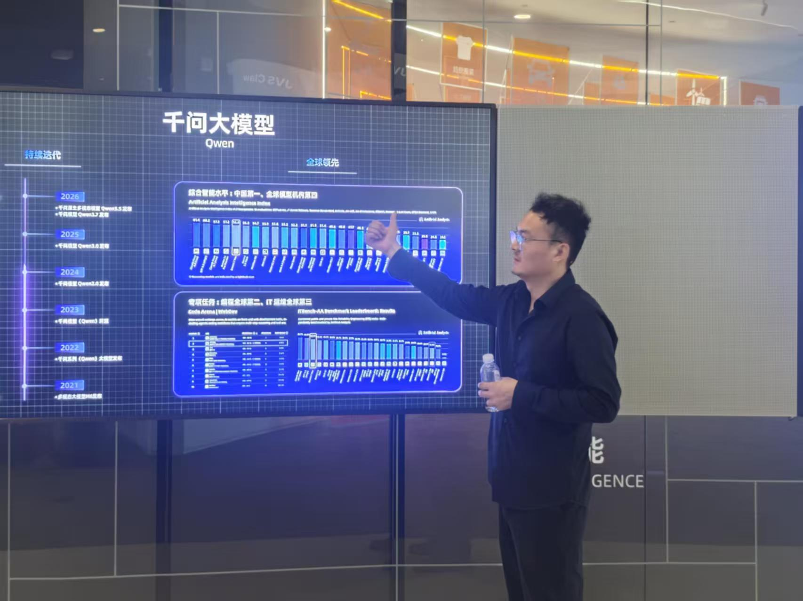
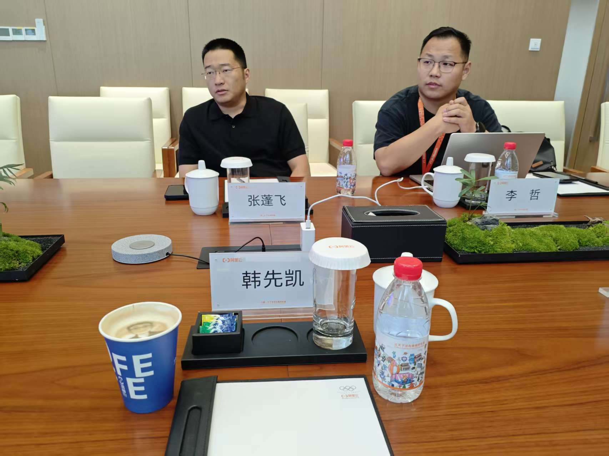
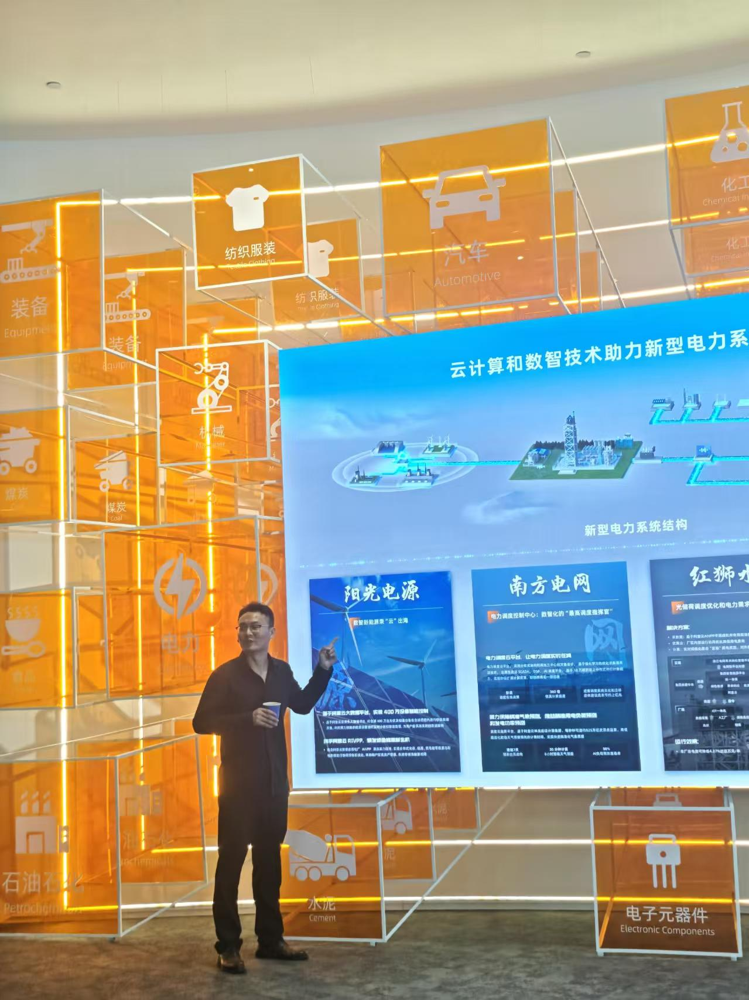
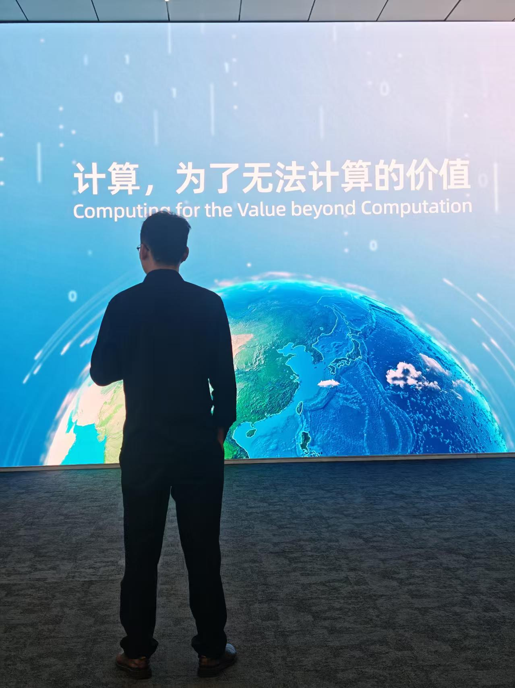

# 韩先凯 / 离谱：从个人站长到 AI 创业，也做过牛肉汤生意

你好，我叫韩先凯，网名 **离谱**，也以 **法海不懂AI** 分享 AI 相关内容。至于吴彦祖的颜值巅峰期，我也只好暂避锋芒。玩笑说过，下面聊聊正事。

我的经历并非一条直线：QQ 空间、iOS 论坛、海外网站、比特币、法律科技、小程序、牛肉汤店、温泉酒店，以及今天的 AI 算力与企业服务，看起来风马牛不相及，却都是真实走过的路。贯穿其中的，是对新事物的好奇，以及把想法付诸实践的冲动。方向是否正确，很多时候要等走过一段才看得清。

很多人通过 [《人生进阶指南》](https://github.com/byoungd/up) 认识我。它起步于 2017 年的一份英语学习指南，后来也记录了生活本身的变化，逐渐写到 AI、产品开发、创业受挫与重新学习。截至 2026 年 9 月 19 日，项目在 GitHub 上已获得超过 6.3 万 Star。动笔时，我原以为自己在整理英语学习方法；后来才发现，真正需要长期学习的，远不止英语。

如今，我担任中国词元云计算有限公司董事长，也持续参与开源写作、企业服务与早期创业支持。头衔说明此刻的职责，经历则解释我为何走到这里。故事要从一个喜欢折腾网页的少年讲起。

## 2007—2014：兴趣先行，创业尚未得名

2007 年前后，我开始制作 QQ 空间和个人主页。排布内容、研究版面，再看看谁来过、谁留言、谁愿意再来，便足以让我忙上许久。后来，人们把其中一些事情称作页面设计、用户互动和流量运营；当时的我没有这些概念，只是想把属于自己的那一小块互联网打理得好看些，也热闹些。

我对“人为什么愿意停留”这件事的兴趣，也由此开始。一个标题、一种排版，或一份恰好有用的资料，都可能改变页面的去向。做一点调整，便能从访问和留言里看到回应。那是我最早感受到的产品反馈：想法落到页面上，便有了被检验的机会。

2011 年，我创办面向 iOS 爱好者的“苹果酒吧论坛”，围绕越狱技术、工具和使用经验建设社区。整理资料、回答问题、维护站点、处理日常事务，都是细活。也是在那时我逐渐明白，社区并非靠热闹维持；真正让人留下来的，是这里确实有用，值得再来。

2012 年，我又搭建了面向海外用户的 WordPress 主题分享与前端资源网站，开始接触搜索流量、内容分发和站点体验。网站上线只是开张，之后的更新、维护与用户增长，才是日复一日的经营。互联网不缺新店，难的是让人愿意常来。

2012—2015 年间，我还参与了比特圈、比特吧等比特币相关项目。这些尝试与网站、社区并行，是我对新技术和新产品的早期探索。回头看，那时最充裕的是好奇心，经验和判断力则在一次次实践里慢慢积累。年轻时常以为新鲜就是机会，后来才知道，机会还要经得起时间和需求的检验。

## 2015—2016：从北京求职，到重新起步

2015 年 3 月 7 日，我去了北京，原本打算找一份实习。几次面试的反馈不错，信心也随之增加；工作尚未落定，对未来的规划倒已经排得很远。随后，学校答辩、毕业手续和实习安排接连改变计划，我只好先回老家。年轻时总觉得前路应当按计划展开，现实通常另有日程。

那段停顿算不上理想，却意外教会了我做饭。彼时自然想不到，这项生活技能日后会派上经营用场。人生有些安排，回头看才显出前后照应。

2016 年，我开始制作电影网站 `bt0.com`，负责内容整理、站点设计和前端交互，也迎来了第一批用户。有人使用，也有人认真提出意见，自己做出的东西终于进入别人的日常。产品的乐趣，大约就在此刻：想法落地之后，终于有了来自真实用户的回音。

随后，我接了一些网站设计项目，也和初中同学开始第一次公司化创业。按当年的[博客记录](https://github.com/byoungd/up/blob/master/docs/threads/archive/last-year-and-now.md)，我们在 2016 年 3 月有了第一家公司，4 月又在沈阳成立互联网公司，业务涉及比特币和游戏娱乐；还计划在南京申请公司，名字想用我一直喜欢的“玩有引力”。

从独自做网站，到和伙伴一起接需求、安排交付、规划支出，我开始真正接触经营。公司名称可以取些诗意，合同、现金流和交付日期却各有章法，容不得只凭兴致行事。

那年我在博客里给自己留过一句话：“想踏踏实实把事情做好，不冒进，少装逼。”多年后再看，这条原则依然中肯；至于执行得如何，只能说知易行难，古今大概相通。

## 2017—2019：从写代码，到理解经营

2017 年 4 月 1 日，我以前端开发身份加入南京一家法律科技公司，参与研发面向律师和律所的软件。入职日期自带一点幽默，工作内容却十分具体：接手外包留下的第一版产品，在不断变化的需求中继续开发。

入职第一个月，我负责的时间轴模块修改了 20 多版。时间轴本为呈现先后，那个月倒让我重新认识了“反复”二字。后来，我主导前端项目以 Vue 重构，半年多后产品终于发布。团队投入很多，期待也很高；只是产品上线并不等于市场买单，销售长期没有起色，我们也一度没有开单。

此后几年，团队有人离开，也有人加入。我仍看好这个产品，于是留了下来，从普通开发逐步做到团队负责人、总经理，并成为合伙人。职责扩大后，关注点也从“功能如何实现”延伸到客户如何使用、需求如何取舍、交付需要多久，以及公司还能承担多少成本。写代码讲求逻辑，经营则常要在几组都不完美的答案里作选择。

也是在 2017 年，我创建了英语学习方法开源项目，后来逐渐扩展为《人生进阶指南》。软件开发的许多劳动留在版本记录里；写作则让我把方法与思考摆到台面上，接受读者检验。一个关于学习的项目，后来成了持续写作与公开复盘的地方。

2018—2019 年，我继续运营多个垂直内容站，尝试 SEO、用户增长和商业化。早年做站更多凭兴趣与直觉，这时开始认真看数据：用户从哪里来，什么内容值得继续投入，哪些忙碌并未带来结果。做得多了便明白，创作者的喜欢固然重要，用户的需要也必须被看见；两者之间，隔着观察、验证和调整。

## 软件创业之外：一碗牛肉汤的经营课

在软件公司之外，我还尝试过温泉度假酒店、会所和餐饮项目。酒店与会所付出了沉重代价；小餐饮则一度带来相对稳定的现金流。几条业务线并行，让我从不同角度体会经营：有些问题藏在长期投入里，有些问题每天都会出现在账本上。

餐饮的起点很具体：亲戚在南京经营淮南牛肉汤店，生意不错。我研究过这个品类，也开了自己的店，效果好于预期，随后又做了第二家、第三家。选址、设计、装修、拓展品类，能自己研究的便亲自上手。为了让外卖页面上的产品更有吸引力，我还学摄影和 Photoshop，做了一整套产品图。做互联网时讲究转化率，开店之后才发现，照片拍得再好，汤也得先过关。

以前对着屏幕调整页面，这次对着一碗汤研究光线和构图。工具换了，想把产品做好、让人看见的心思却没有变。所谓跨界，有时并不玄妙，不过是把熟悉的本领带到陌生的场景里。

餐饮让我每天面对具体问题：客流如何、出餐是否及时、口味能否稳定、收入能否覆盖租金和人工。软件版本可以排期，房租却不会等产品经理确认需求。小店经营辛苦，但也带来过不错的现金流，为我后来入股软件公司打下资金基础。

两段生意由此交织起来：门店的收入，支持着软件事业的投入。疫情到来后，门店陆续关停，我也更深地体会到，现金流会随环境变化；业务多元可以分散部分风险，却不会让风险自行消失。账本从不因为理想而宽容，也因此值得认真对待。

## 2020—2021：一个人的产品团队

2020 年，我独立开发并运营一款 C 端小程序。从产品定位、设计、开发，到迭代、营销和商业化，大多由我一人完成。一个人做产品，沟通链路确实很短：需求评审开到最后，产品、设计和开发总能迅速达成一致，毕竟都是同一个人。

按我公开的[《离谱的小程序指南》](https://github.com/byoungd/how-to-create-a-funny-mini-program)介绍，这款产品的用户量达到 1400 万。数字背后，是定位、试错、传播和持续运营，也是许多不起眼的日常决策累积而成的结果。

后来，我发起《离谱的小程序指南》，围绕定位、设计、开发、迭代、营销和增收整理经验。结果未必可以复制，过程中做过的判断、取舍和走过的弯路，倒值得坦诚交流。经验的价值，不在于替别人作答，而在于让问题看得更清楚。

2021 年，我成立江苏红力科技集团有限公司，作为科技、企业服务及多元业务发展的重要主体之一。至此，我做过网站、小程序、企业软件和实体经营，积累了不少经验；但后来才更清楚地认识到，经历丰富不等于判断总是准确。见过的事情多了，仍需对自己的结论保持审慎。

## 2022：技术债务之外，还有经营的账

软件公司也曾走过一段令人相信前景的日子。收支逐渐接近平衡，我们搬进更大的办公室，招募年轻同事，改善工作环境与福利。我曾站在尚未装修的展台前畅想未来。那份期待是真的，后来不得不面对的失望也是真的。

2022 年初，软件销量明显下滑，客户反馈与交付压力逐渐集中。为了补上关键短板，我邀请当时在字节从事容器安全工作的高中同桌加入。他的到来，帮助我们看清了一些此前未能解决的深层问题。

项目架构老旧，性能和安全存在隐患；一些被称作“大数据”和“AI”的功能，缺少可用数据集与训练流程，实际能力仍停留在搜索和预设结果上。过去我们投入大量精力优化界面、适配多端、增加模块，却没有把核心的数据基础打牢。功能可以不断增加，根基却不能靠命名补齐。

到这时，继续在旧架构上修改，成本越来越高；整体重构，又需要公司难以承担的时间和资金。技术问题最终写进了经营账本，销售、交付和团队士气都受到影响。代码可以回滚，时间与信任却没有同样简单的恢复按钮。

后来，公司开始无法按时发放工资，资金压力又引发管理冲突与持续高压。2022 年 9 月，团队集体辞职；我参与五年多的软件创业，也走到了终点。

这段经历，我写进了[个人复盘](https://github.com/byoungd/up/blob/master/docs/threads/part-2/my-story.md)。最难落笔的始终是一起做事的人：熬夜攻坚的同事、受我邀请加入的朋友，以及为我的决定承受压力的家人。我曾笃定地谈过未来，最后却没能交出承诺的结果。对共同承担过的人，解释永远不如诚实面对来得重要。

我也曾用“年轻时摔一跤”安慰自己，可这句话太轻，装不下五六年的时间。后来我学着承认难过，承认判断有误，也承认努力不能替所有决定辩护。复盘不是为了把过去说得好听，而是尽量弄清自己究竟错在哪里。

## 2023：把生活重新安顿好

2023 年 3 月底，我转让了最后一家小餐饮店；6 月底，收拾行李，和家人离开南京，回到老家。

长期压力影响了身体，也打乱了生活。那段时间，我退出一些群，关掉 GitHub，不再打开从前每天都会浏览的技术网站。一个习惯从解决问题中获得信心的人，忽然发现连日常生活也需要重新照料，这份失落并不能靠几句鼓励轻轻带过。

后来，生活才一点点回到可以照料的范围：按时吃饭、好好休息、出门走走，重新读些东西，再试着做些事情。我开始整理旧项目和文章，把曾不愿回看的经历慢慢写下来。写作替记忆理出一些秩序，让我得以回望过去，也得以重新审视当年的自己。

这一年，我也尝试了社交平台“酷圈（ku0.com）”。后来，这个域名又承载了 AI 资源方向的探索。项目几经变化，我与产品、技术的联系，也在新的尝试中逐渐接续起来。

2023 年末，我通过天津的主体公司继续探索餐饮管理、商业管理和文化娱乐业务。结束门店经营后，我开始重新思考如何组织业务、分配精力，以及怎样在问题变得难以承受之前，及时识别它们。许多教训并不新鲜，难的是在代价变大之前听见它们。

## 2024—2026：重整事业，也支持后来者出发

2024 年 1 月，我成立观雪控股（山东）有限责任公司，作为企业管理、技术开发、食品零售、文旅和商业管理等业务的控股平台。经历过不同类型的项目后，我更加在意责任如何划分、资源如何安排，以及收入与支出能否形成可持续的结构。

这一阶段，我也开始更系统地用自有资金支持早期创业团队，尤其关注大学生创业者、技术型青年团队，以及能把产品真正交到用户手里的小团队。除启动资金外，我也提供产品判断、技术资源、商业化建议和经营复盘。

听年轻人介绍自己的产品，我常会想起当年刚开始做网站的自己。我愿意认真听他们的想法，也愿意陪他们把问题拆得更具体：第一批用户在哪里，最先应该完成什么，服务一位客户需要多少成本，到了什么时候该调整方向。

这些问题不如谈愿景振奋，却常能替团队省下时间。走过弯路的人，难免希望后来者少绕一些；但经验只能照亮局部，不能代替他们自己选择道路。

## 2026：重返 AI，也带着旧经验重新出发

2026 年 6 月，中国词元云计算有限公司在香港注册成立，我以董事长身份开始新一轮 AI 服务创业。同年，我们与江苏问剑云计算有限公司开展深度合作，围绕算力资源、模型服务、企业交付和产业场景推进联合布局。

过去的软件经历让我对一些细节格外敏感：模型接入之后是否稳定，演示跑通之后能否进入客户的工作流程，调用量增长之后成本与服务是否跟得上。这些问题听起来寻常，真正做好却需要长期投入。技术不止于能运行，还要经得起日常使用。

2026 年 6 月 16 日，我以中国词元云计算有限公司董事长身份参访阿里云杭州总部，围绕千问大模型、云计算与 AI 产业应用交流。重新走进技术与产业现场，我又看见许多值得亲手验证的方向。

其中一个方向，是探索 AI 在农、林、牧、渔、农村合作社和中小企业中的实际用途。我也计划为农村合作社开展免费 AI 培训，让更多人有机会理解并使用这些工具。它能否减少重复劳动、理清资料、改善流程，不能只靠想象判断，需要放进具体场景逐项验证。

这些工作仍在推进。对今天的我来说，把一次接入做好，把一项服务交付稳妥，把一个实际问题解决清楚，便是值得继续做下去的理由。

## 现在在做的事

一路讲来，提到了不少项目与公司。为便于查阅，截至 2026 年 6 月，主要业务主体和分工如下：

| 方向 | 主要主体 |
| --- | --- |
| 科技与 AI 服务 | 江苏红力科技集团有限公司、南京玩有引力信息科技有限公司、中国词元云计算有限公司 |
| AI 算力合作 | 江苏问剑云计算有限公司（合作方） |
| 控股与企业管理 | 观雪控股（山东）有限责任公司 |
| 实体与商业管理 | 宝藏互娱文化娱乐（天津）有限公司、万理江山（天津）商业管理有限公司、万丽（天津）餐饮管理有限公司等 |

目前，我在 AI 方向参与的产品和工作主要包括：

- **[token.love](https://token.love/)：统一 AI 网关。** 面向开发者、团队与企业应用，提供多模型接入、路由容灾、用量计量、访问审计和私有化部署等能力。
- **[ku0.com](https://ku0.com/)：AI 资源目录。** 我参与其运营与介绍，为企业和开发者整理 AI 服务、模型工具及相关资源入口。
- **算力与企业交付。** 与合作伙伴围绕 GPU / 智算资源、模型推理、训练与微调、部署运维和成本管理开展工作，让资源能够进入实际项目。
- **早期团队与实体应用。** 为年轻团队提供模型接入、算力试用和产品验证方面的支持，继续探索 AI 培训与产业应用。

此外，也推荐一个第三方服务：[biezou.com · 别走中转](https://biezou.com/)，提供统一 AI API 网关与管理面板，可作为了解模型接入服务的一个入口。

关于我参与的产品和项目，可以继续看[作者项目与现实实践](https://github.com/byoungd/up/blob/master/docs/projects.md)。

## 写在最后：仍愿意动手，也更懂得取舍

从给 QQ 空间排版，到为牛肉汤拍照，再到思考企业如何接入 AI，这一路换过许多工具，也遇见许多不同的问题。我仍喜欢亲手做出一些东西，看看它们进入真实生活之后，能带来怎样的反馈。

如今做计划，我会记得为身体、家人和一起做事的人留出位置。有些事值得长期投入，有些事则应及时止步。知道何时坚持、何时调整，并不比开始一件事容易，这门功课我还在学。

《人生进阶指南》还在更新，我的生活也仍在继续。过去总想尽快交出一份漂亮答卷，如今更愿意把思考和修改的痕迹一并留下。人生未必每一页都写得漂亮，但至少可以尽量写得诚实。

我叫离谱，也叫韩先凯。谢谢你读到这里，认识一个仍在做事、也仍在学习的人。

  
  

  
  

<em>2026 年 6 月，阿里云杭州总部参访留影。</em>

---

若想继续了解，可以从这些文章开始：[人生进阶指南](https://github.com/byoungd/up) · [完整创业复盘](https://github.com/byoungd/up/blob/master/docs/threads/part-2/entrepreneurship.md) · [我的故事](https://github.com/byoungd/up/blob/master/docs/threads/part-2/my-story.md) · [小程序指南](https://github.com/byoungd/how-to-create-a-funny-mini-program) · [另一份个人介绍](https://www.doubao.com/thread/xa6d27fc9d561832699480888ede569d5)。

*更新于 2026 年 10 月 29 日。*
